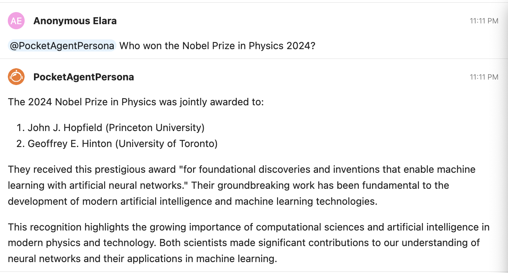
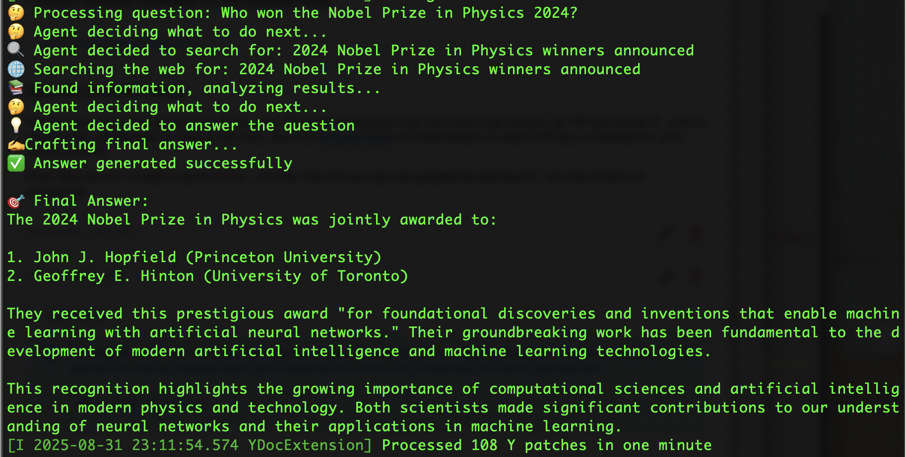

# Using PocketFlow in Jupyter AI Personas

In this `pocketagent_persona` we explain how any application in the PocketFlow respository ([GitHub](https://github.com/The-Pocket/PocketFlow)) can be adapted to work within `jupyter-ai-personas`. PocketFlow provides many examples in its [cookbook](https://github.com/The-Pocket/PocketFlow/tree/main/cookbook).

PocketFlow has four main classes:

1. `Node`: this is the atom of the system, which performs a single task in 3 steps using these methods in sequence: `prep`, `exec`, `post`.
2. `BatchNode`: batches multiple tasks where the `prep` method returns an iterable.
3. `Flow`: This is the master recipe, a compute graph.
4. `AsynParallelBatchFlow`: for efficient processing when needed, so that the graph need not be processed sequentially if not strictly necessary.

There are 3 core abstractions:

1. Node: a single focused worker, described above.
2. Shared Store: this is a _global_ dict, containing as many state variables as needed. It is always called `shared`. (It is unclear if there are race conditions that make this shared state uncertain when `AsynParallelBatchFlow` is applied.)
3. Flow: connects nodes (the graph, it can be cyclic, not just a DAG).

In a `Node`, the three methods do the following:

- `prep` takes the input and preprocesses it to make a message for the `exec` method.
- `exec` calls a LLM to respond to the message.
- `post` prints the response if needed, and also emits an action based on the response, such as "continue" to continue the conversation.

That's it!

PocketFlow applications usually devolve into four modules, which can be combined into a single persona in `jupyter-ai`. These four modules are:

1. `utils.py` -- various functions needed for the app, such as web search, etc. Think of it as containing tools.
2. `nodes.py` -- contains one or more `Nodes`, each of which is a class that inherits the base `Node` class. This uses modules in `utils.py`.
3. `flow.py` -- initializes the Nodes in `nodes.py` and sets up the agent flow.
4. `main.py` -- sets up inputs and calls the flow in `flow.py`.

You will usually find these files in the PocketFlow cookbook examples.

The starting template to inject these modules into a persona is to create the following initial version of `persona.py` with 3 Nodes:

```python
from jupyter_ai.personas.base_persona import BasePersona, PersonaDefaults
from jupyterlab_chat.models import Message
from pocketflow import Node, Flow
from litellm import completion

#### ADD ALL FUNCTIONS FROM utils.py HERE #####

#### ADD ALL NODE CLASSES FROM nodes.py HERE

#### PERSONA #####
class PocketAgentPersona(BasePersona, Node1, Node2, Node3):
    def __init__(self, *args, **kwargs):
        BasePersona.__init__(self, *args, **kwargs)
        Node1.__init__(self)
        Node2.__init__(self)
        Node3.__init__(self)

    @property
    def defaults(self):
        return PersonaDefaults(
            name="PocketAgentPersona",
            avatar_path="/api/ai/static/jupyternaut.svg",
            description="The pocketflow agent.",
            system_prompt="...",
        )

    ## UTILS (within the Persona class)
    def call_llm(self, prompt):
        # If messages is a string, convert it to proper message format
        if isinstance(prompt, str):
            prompt = [{"role": "user", "content": prompt}]
        response = completion(
            model=self.config_manager.chat_model,
            messages=prompt,
            stream=False,
        )
        return response.choices[0].message.content

    async def process_message(self, message: Message):
        ## FLOW: USE THE CODE FROM flow.py HERE
        n1 = Node1()
        n2 = Node2()
        n3 = Node3()
        n1.persona = self
        n2.persona = self
        n3.persona = self
        # Connect the nodes, the `action` is in quotes
        n1 - "n2" >> n2
        n1 - "n3" >> n3
        n2 - "n1" >> n1
        ## Flow: Run the flow with the input message
        agent_flow = Flow(start=decide)

        ## MAIN: USE THE CODE FROM main.py HERE
        question = message.body.split(" ", 1)[1]
        shared = {"question": question} {message.body.split(" ", 1)[1]}")
        agent_flow.run(shared) # flow runs off shared
        self.send_message(shared.get("answer", "No answer found"))
```

Notice that the code from `utils.py` and `nodes.py` goes above the Persona class. The code from `flow.py` and `main.py` goes inside the Persona class with the `process_message` function. The following modifications to the original PocketFlow code are required to use the LLMs that are designated in AI Settings in `jupyter-ai`:

- The `call_llm` method in `utils.py` is deleted and replaced by the one used by `jupyter-ai` -- see it included in the `PocketAgentPersona` class in the code above.
- The `PocketAgentPersona` class inherits all the Node classes and initializes them. See the statements such as `Node1.__init__(self)` and `n1.persona = self` that are required.
- The `call_llm` statements in the `exec` module of each Node are replaced by `self.persona.call_llm`.

See the `persona.py` file in the `pocketagent_persona` folder. This persona has been built using the [code](https://github.com/The-Pocket/PocketFlow/tree/main/cookbook/pocketflow-agent) in PocketFlows cookbook for a simple agent that answers question using a search tool if it needs to in case the LLM does not have the required answer memorized.

You will also need to add the persona to `pyproject.toml` as follows:

```
pocketagent = [
    "pocketflow",
    "duckduckgo_search",
    "requests",
]

all = ["jupyter-ai-personas[<other-personas>, pocketagent]"]

[project.entry-points."jupyter_ai.personas"]
pocketagent_persona = "jupyter_ai_personas.pocketagent_persona.persona:PocketAgentPersona"
```

Running this persona gives the following output:

with the agentic iterations logged to console:

